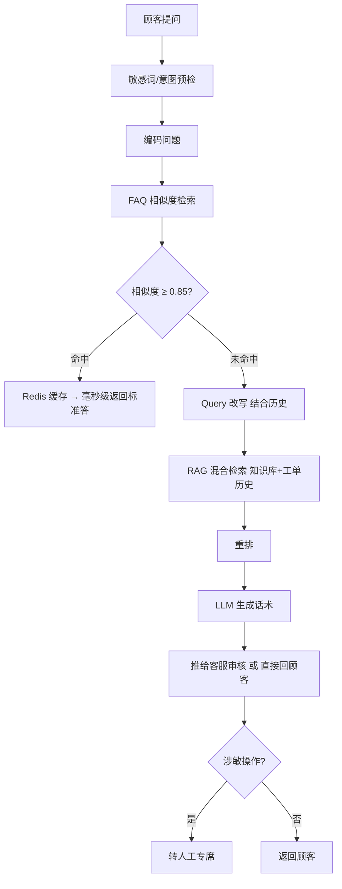

# 案例二 · 智能客服 Copilot（优选商城）

> **一句话**：一家电商平台的客服中心，被大促投诉逼出来的"双通道客服助手"——高频问秒回，长尾问走 RAG，客服提效。
>
> *说明：公司名为化名，业务背景、流程、指标按真实电商客服项目的典型情况还原。*

---

## 一、项目名片：谁、为什么、解决什么

| 项 | 内容 |
|---|---|
| **公司** | 优选商城（化名）· 综合电商平台 · 日活百万级 |
| **发起部门** | 客户体验部（客服中心）· 联合技术部 |
| **买单人** | 客服中心总监 —— 被大促差评和人力成本双重压着 |
| **谁在用** | 一线客服（辅助）+ 终端顾客（自助） |
| **解决什么** | 高峰期响应慢、答案不一致、重复问占人力 |
| **入口** | App / 网页 在线客服窗口 + 客服工作台 |

---

## 二、业务背景：什么事把这个项目逼出来的

优选商城客服中心约 300 人，平时够用，但**每逢大促就爆仓**。2025 年双 11 复盘，几个数字很难看：

- 大促当天客服在线咨询量是平时的 **6 倍**，顾客平均**等待 8 分钟**才接入，大量顾客直接给差评；
- 分析工单发现，**约 40% 是重复的标准问**："我的订单什么时候发货""怎么退货""运费怎么算"；
- 新客服培训跟不上业务更新，**同一个问题不同客服答得不一样**，引发二次投诉；
- 退换货、发票这类问题客服要**翻好几个系统**才能答，处理慢。

客服总监的诉求很直接：**"高频简单的问题让机器秒答，把人力省下来处理真正复杂的；而且答案要一致、要快。"**

技术部给的方案核心是**双通道分流**：高频标准问走 FAQ（毫秒级），长尾复杂问走 RAG（秒级），既快又能覆盖。（这正是 EduRAG 教程"⑥ 融合 MySQL 的 RAG 系统"那一章的思路。）

---

## 三、系统业务流程：真实工作里谁在什么地方做什么

1. **顾客小王**：在 App 订单页点"联系客服"，问"我的订单还没发货怎么办"。
2. **系统（机器人先接）**：先做敏感词/意图预检 → 编码问题查 FAQ → **命中标准问（相似度 ≥ 0.85）**，从 Redis 缓存**毫秒级**返回标准答："您的订单预计 24 小时内发货，超时可催单或退款……"
3. **小王追问**："我买的那个是预售的，也是 24 小时吗？" —— FAQ 没命中（长尾）→ 转 **RAG 通道**：结合上文改写问题 → 检索知识库（含预售政策）+ 历史工单 → 生成答案。
4. **需要人工时**：小王要求退差价（涉敏操作）→ **转人工**，同时系统把 **RAG 生成的建议话术**推给接手的客服。
5. **客服小张**：工作台上直接看到系统给的建议话术和相关政策链接，**一键采用或改两句发出**，不用自己翻系统，处理速度快很多。
6. **运营**：定期看"机器人解决率、转人工率、被问最多的问题"，把高频长尾问**补进 FAQ**，让机器人下次能直接答。

**关键设计**：① 机器人先扛、人工兜底；② 对客服是"**副驾**"（给话术让人审），不是取代；③ 涉及钱的操作一律转人工。

---

## 四、核心痛点 → 技术如何应对

| 业务痛点 | 技术应对 |
|---|---|
| 高频问要极快、还要省钱 | FAQ 精确匹配 + Redis 缓存，毫秒级、几乎零成本 |
| 长尾问 FAQ 覆盖不了 | 未命中转 RAG，检索知识库+工单历史 |
| 口语化、带上下文的追问 | 结合历史会话做 Query 改写，补全指代 |
| 答案要一致 | 标准答统一维护在 FAQ，不靠客服临场发挥 |
| 涉及退款等敏感操作 | 敏感词/意图识别，强制转人工 |
| FAQ 更新后不能答旧内容 | 更新即重建向量 + 清对应缓存 |

---

## 五、数据流

**在线查询（双通道分流）**



---

## 六、接口设计

### `POST /api/chat` — 顾客提问，返回答案 + 来源通道
请求：
```json
{
  "session_id": "s-2231",
  "message": "我的订单还没发货怎么办",
  "user_id": "c99001"
}
```
响应：
```json
{
  "reply": "您的订单预计 24 小时内发货，如超时可催单或申请退款……",
  "channel": "faq",
  "confidence": 0.91,
  "need_human": false,
  "latency_ms": 12
}
```
> `channel` 取值：`faq`（命中标准问）/ `rag`（长尾走检索）/ `human`（转人工）。

### `POST /api/faq/upsert` — 运营维护 FAQ（更新会重建向量 + 清缓存）
```json
{ "std_q": "退货政策", "answer": "7 天无理由……", "similar_q": ["怎么退货", "能退吗"] }
```

---

## 七、核心伪代码

**① 双通道分流主逻辑**
```python
def chat(session_id, message, user_id):
    # 0. 敏感词/涉敏操作（退款/投诉）直接转人工
    if is_sensitive(message):
        return {"channel": "human", "need_human": True}
    # 1. 编码问题，先查 FAQ（语义匹配，不止字面）
    q_vec = bge_m3(message)
    faq = milvus.search("faq_vec", q_vec, limit=1)[0]
    # 2. 高置信 → 走 FAQ 通道（优先读 Redis 缓存）
    if faq.score >= 0.85:
        ans = redis.get(faq.id) or load_answer(faq.id)
        redis.setex(faq.id, TTL, ans)
        return {"reply": ans, "channel": "faq", "confidence": faq.score}
    # 3. 低置信 → 走 RAG 通道（覆盖长尾）
    return rag_answer(message, session_id)
```

**② RAG 通道：Query 改写 + 混合检索 + 生成**
```python
def rag_answer(message, session_id):
    history = get_history(session_id)
    q = rewrite_query(message, history)          # 历史会话改写，补全"它/这个"
    hits = milvus.hybrid_search(q, collection="kb", limit=5)
    ranked = reranker.rank(q, dedup_parents(hits))[:2]
    if not ranked or ranked[0].score < THRESHOLD:
        return escalate_to_human(session_id)     # 检索不到就转人工
    return {"reply": llm.generate(prompt(q, ranked, history)), "channel": "rag"}
```

**③ FAQ 维护：更新即重建向量 + 清缓存（保证一致）**
```python
def upsert_faq(std_q, answer, similar_q):
    fid = save_to_mysql(std_q, answer, similar_q)
    for text in [std_q] + similar_q:             # 标准问+相似问都编码，提高召回
        milvus.upsert("faq_vec", {"id": fid, "vec": bge_m3(text)})
    redis.delete(fid)                            # ★清旧缓存，避免答过时内容
```

---

## 八、数据模型

| 存储 | 内容 | 作用 |
|---|---|---|
| MySQL `faq` 表 | 标准问 / 标准答 / 相似问列表 / 分类 | 结构化标准问答对 |
| Milvus `faq_vec` | 每个标准问的向量 | 语义匹配 FAQ（不止字面） |
| Redis | `hash(question) → answer` | 热点问缓存，毫秒返回 |
| Milvus `kb` | 产品手册 / 工单历史 的父子块向量 | RAG 长尾检索 |

---

## 九、团队、周期与上线效果

**团队（6 人）**：1 产品（客服业务出身）· 2 后端 · 1 算法 · 1 前端 · 1 客服业务专家（负责 FAQ 梳理）。

**周期**：MVP 5 周（先上物流/退换货两类高频问），迭代上线约 3 个月。

**上线效果（参考）**：

| 指标 | 变化 |
|---|---|
| 机器人自助解决率 | 约 55%（重复问基本机器答） |
| 平均首次响应 | 分钟级 → 秒级 |
| 大促人工咨询量 | ↓ 约 40% |
| 客服单均处理时长 | ↓（有建议话术，不用翻系统） |

---

## 十、可复用经验

1. **双通道是性价比核心**——别啥都上 RAG，高频问用 FAQ+缓存又快又省；
2. FAQ **命中率就是省钱率**，运营持续把长尾补进 FAQ；
3. 阈值（0.85 附近）要按业务反复调：高了漏命中走慢 RAG，低了误命中答错；
4. FAQ 更新**必须清缓存**，否则一直答过时内容；
5. 先做"**辅助客服**"（生成话术给人审），跑稳了再逐步开放直接回顾客；
6. 涉及钱的操作**一律转人工**，AI 不碰资金动作。

> **内核** = 混合检索 + 重排；**业务外壳** = 双通道 + 缓存 + 安全边界。
