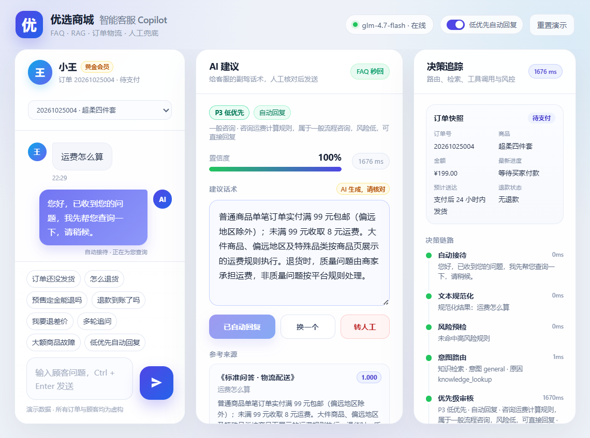
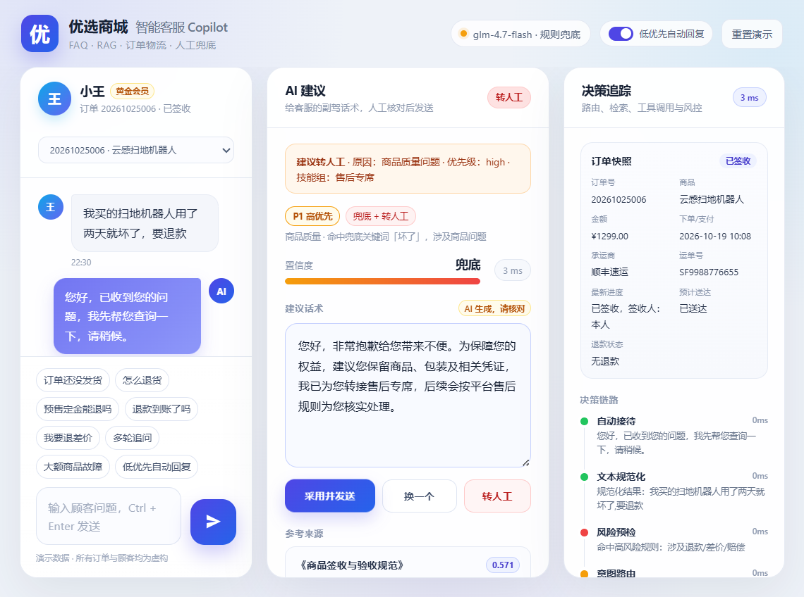
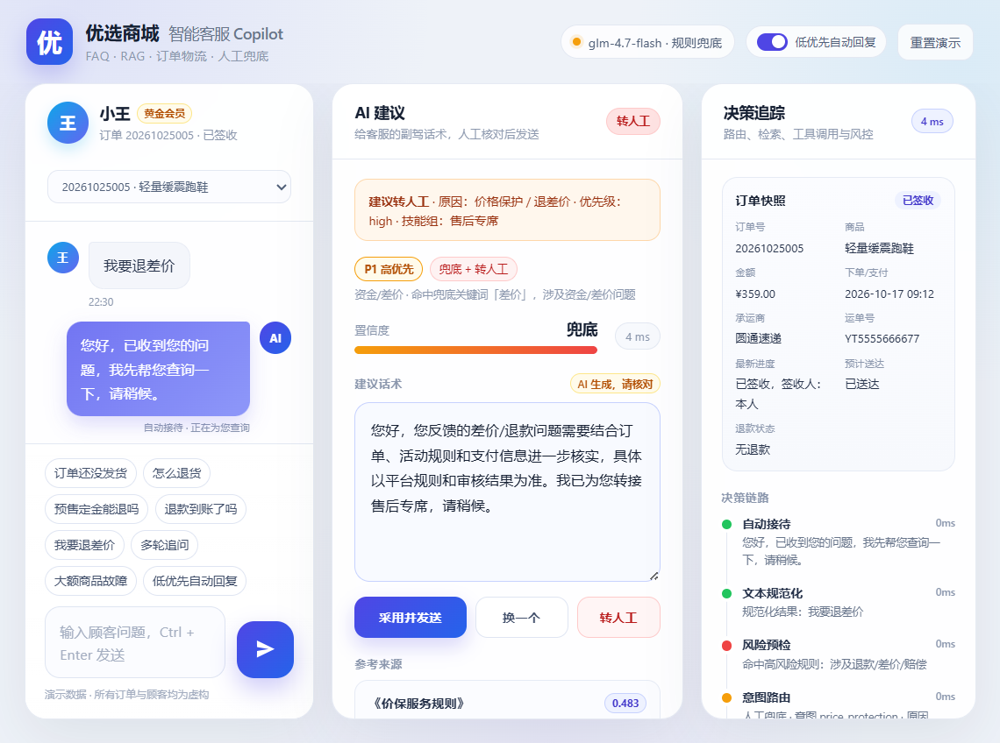

# 优选商城 · RAG 智能客服 Copilot

一个面向电商客服场景的 **RAG + 订单工具 + 人工兜底** 演示项目。

- 设计文档：`技术设计方案_RAG智能客服_v1.md`
- 业务原型：`02_智能客服.md`
- 当前形态：**优先级分流 + Copilot**（P3 低优先自动回复；P1/P0 兜底并转人工）
- 模型：**智谱 GLM-4.7-Flash**（公有 API，关闭思考模式以降低延迟和成本）
- 技术栈：Python 3.12 + FastAPI + SQLite（Demo）+ 本地混合检索

---

## 1. 已实现的能力

| 能力 | 说明 |
|---|---|
| 四通道分流 | FAQ / RAG / 订单物流 Tool / 人工兜底 |
| 优先级分流 | P0–P3 四级；规则兜底 + GLM 分级，模型只能抬高、不能降低规则优先级 |
| 低优先自动回复 | P3 低风险问题由 GLM 决定 `auto_reply`；只有模型允许且置信度达标才直接回复 |
| 自动接待 | 收到问题先自动发送“已收到，正在查询”的接待语，再由 GLM 审核并决定后续 |
| 类目兜底 | 商品质量/资金差价/大额订单/物流/发票/地址/投诉分别配置话术与技能组 |
| 高风险兜底 | 退款/差价/商品质量/大额订单/投诉 → 类目兜底话术 + 转人工 |
| 合规话术 | 委婉表达、不承诺一定退款/赔偿、说明“具体以平台规则和审核结果为准” |
| FAQ 秒回 | 精确匹配 + 字符 n-gram 语义匹配 + 阈值/分差双重门槛 |
| RAG 检索 | BM25 + 字符 bigram + 关键词 + 标题相似度 + 轻量重排 |
| 订单/物流查询 | 只读 Mock API：订单状态、物流、退款进度 |
| 上下文改写 | 多轮追问时补全“这个/那/定金”等指代 |
| 风险预检 | 退款、退差价、投诉、改地址、取消订单等涉敏动作转人工 |
| 引用来源 | 每条建议展示知识库标题、条款、分数、摘要 |
| 决策追踪 | 展示规范化、风控、路由、优先级、FAQ、检索、Tool、生成、输出风控 |
| 转人工上下文包 | 摘要、订单快照、引用、草稿、风险标签、技能组、优先级 |
| 反馈闭环 | 采用 / 编辑 / 有用 / 无用 / 答错 / 政策过期 |
| 降级 | 模型限流/失败自动降级为本地模板，并在界面标记 |
| 评测 | 24 条 pytest 覆盖四通道、优先级、自动回复、类目兜底、接待语、合规话术、多轮、反馈、转人工 |

---

## 2. 快速启动

### 2.1 安装依赖

项目使用 `uv` 管理 Python 环境（本机已安装）：

```powershell
cd D:\AI客服
uv sync
```

### 2.2 配置模型

复制 `.env.example` 为 `.env`，填入智谱 API Key：

```powershell
Copy-Item .env.example .env
notepad .env
```

`.env` 关键配置：

```dotenv
ZHIPU_API_KEY=你的智谱APIKey
ZHIPU_BASE_URL=https://open.bigmodel.cn/api/paas/v4
ZHIPU_MODEL=glm-4.7-flash
ZHIPU_DISABLE_THINKING=true
ZHIPU_MAX_TOKENS=800
ZHIPU_TIMEOUT_SECONDS=10
ZHIPU_TOTAL_TIMEOUT_SECONDS=8
ZHIPU_MAX_RETRIES=2
ZHIPU_RETRY_BACKOFF_SECONDS=1
ZHIPU_COOLDOWN_SECONDS=20
PRIORITY_TOTAL_TIMEOUT_SECONDS=3
PRIORITY_LARGE_AMOUNT_THRESHOLD=500
LLM_MODE=zhipu
```

说明：

- `ZHIPU_DISABLE_THINKING=true`：GLM-4.7-Flash 是推理模型，客服话术不需要思维链；关闭后可避免 token 全被 `reasoning_content` 占用。
- `ZHIPU_TOTAL_TIMEOUT_SECONDS=8`：单次生成的总时间预算；超时或遇到 429/5xx 会降级为本地模板，避免页面长时间等待。
- `ZHIPU_COOLDOWN_SECONDS=20`：触发限流/超时后，20 秒内直接使用本地模板，避免连续重试放大延迟。
- `PRIORITY_TOTAL_TIMEOUT_SECONDS=3`：优先级分类的独立时间预算；超时则使用规则分级，不阻塞主链路。
- `PRIORITY_LARGE_AMOUNT_THRESHOLD=500`：大额订单阈值；金额达到阈值且涉及售后/退款/商品/投诉时，至少 P1 并走兜底。
- `LLM_MODE=zhipu`：强制调用智谱；失败会自动降级为本地模板。
- 不想调用 API 时，把 `LLM_MODE` 改成 `mock`，Demo 仍可完整运行。
- `.env` 已在 `.gitignore` 中，不会进入版本库。

### 2.3 启动

```powershell
uv run uvicorn app.main:app --host 127.0.0.1 --port 8000 --reload
```

或双击/运行：

```powershell
.\run_demo.bat
```

打开浏览器访问：

```text
http://127.0.0.1:8000
```

---

## 3. Demo 场景

页面左侧有 8 个快捷场景，建议按顺序体验：

| 场景 | 顾客问题 | 通道 | 优先级/策略 | 演示点 |
|---|---|---|---|---|
| 订单还没发货 | 我的订单还没发货怎么办 | Tool | P2 · Copilot | 查订单 + 引用发货时效规则 |
| 怎么退货 | 怎么退货 | FAQ | P2 · Copilot | 高频标准问毫秒级命中 |
| 预售定金能退吗 | 预售商品定金能退吗 | RAG | P1 · Copilot | 长尾政策检索 + 人工复核建议 |
| 退款到账了吗 | 退款到账了吗 | Tool | P2 · Copilot | 只读查退款进度，不执行写操作 |
| 我要退差价 | 我要退差价 | Human | P1 · 兜底 + 转人工 | 涉钱写操作，兜底话术 + 上下文包 |
| 多轮追问 | 先问“预售什么时候发货”，再问“那定金能退吗” | RAG | P1 · Copilot | 上下文改写 + 指代补全 |
| 大额商品故障 | 我买的扫地机器人用了两天就坏了，要退款 | Human | P1 · 兜底 + 转人工 | 大额订单 ¥1299 + 商品质量，强制兜底 |
| 低优先自动回复 | 运费怎么算 | FAQ | P3 · 自动回复 | 低风险规则问，模型自动回复 |

每个场景会重置会话，保证演示结果稳定。右上角可切换“低优先自动回复”开关：开启时 P3 自动发送，关闭时所有问题都回到 Copilot 建议模式。

> 交互顺序：顾客提问 → 系统立即自动发送接待语“您好，已收到您的问题，我先帮您查询一下，请稍候。” → GLM 做优先级审核 → 根据结果自动回复 / Copilot / 兜底转人工。

### Demo 预览

低优先自动回复：



大额商品质量问题的兜底与转人工：



“差价”类资金问题的兜底与转人工：



---

## 4. 架构

```text
顾客 / 客服工作台
        │
        ▼
   Chat API（FastAPI）
        │
        ▼
   预处理 & 风控
   ├─ 文本规范化 / 乱码修复
   ├─ 敏感词 / 涉敏动作识别
   └─ 会话上下文 / 指代判断
        │
        ▼
   优先级判定（P0–P3）
   ├─ 规则兜底：安全/资金/商品/大额/投诉 → 抬高优先级
   ├─ GLM 分级：P2/P3 模糊问题做补充判断
   └─ 模型只能抬高，不能降低规则优先级
        │
        ▼
      意图路由
   ├─ P3 低优先：FAQ/RAG 结果 → 自动回复（可开关）
   ├─ P2 中优先：FAQ/RAG/Tool → Copilot 建议 → 人工复核
   ├─ P1 高优先：兜底话术 + 转人工（商品/大额/退款/投诉）
   └─ P0 紧急：直接转人工 + 上下文包
        │
        ▼
   输出风控 → 建议话术 / 引用 / 风险提示
        │
        ▼
   Copilot 工作台（自动回复 / 采用 / 编辑 / 换一个 / 转人工）
```

### 4.1 优先级与兜底策略

| 优先级 | 典型问题 | 默认处理 | 是否自动回复 |
|---|---|---|---|
| **P0 紧急** | 人身安全、食品安全、诈骗/盗刷、账户被盗、法律/监管、媒体曝光 | 立即转人工，优先队列 | 否 |
| **P1 高优先** | 退款/退差价/退定金/赔偿、商品质量/破损/错漏发、大额订单售后、投诉 | 兜底话术 + 转人工；纯规则问可 Copilot | 否 |
| **P2 中优先** | 物流异常、退货换货流程、退款进度、发票、改地址、订单状态 | Copilot 建议，人工复核 | 否 |
| **P3 低优先** | 运费/包邮、发货时效、会员权益、一般流程咨询、问候 | 模型自动回复（可开关） | 是 |

**关键安全规则**：

1. **规则是下限，模型是补充**：规则命中 P0/P1、商品问题、大额订单时，不再让模型降低优先级。
2. **商品问题必须兜底**：质量、破损、故障、错漏发、假货、过期、安全问题 → 至少 P1，使用“保留凭证 + 转售后专席”的兜底话术。
3. **大额订单必须兜底**：订单金额 ≥ `PRIORITY_LARGE_AMOUNT_THRESHOLD`（默认 500）且涉及售后/退款/商品/投诉 → 至少 P1。
4. **涉钱写操作必须兜底**：我要退款/退差价/退定金/赔偿 → P1 兜底 + 转人工；仅查询“退款到账了吗”属于 P2 状态查询。
5. **“差价”一律转人工兜底**：`差价`、`退差价`、`价保` 等资金词命中即 P1，不自动回复，具体以平台规则和审核结果为准。
6. **特殊关键词直接兜底**：`商品坏了`、`差价`、`质量有问题`、`破损`、`故障`、`漏发`、`错发`、`假货`、`过期`、`变质`、`不安全` 等命中即至少 P1，不再看金额。
7. **低优先自动回复有门槛**：仅 P3、无商品/资金/大额/投诉风险、置信度 ≥ 0.6 时自动发送；否则进入 Copilot。
8. **所有 P1/P0 都保留人工入口**：即使模型给出兜底话术，也不自动执行退款、改地址、取消订单等写操作。

**P3 / P1 / P2 的大模型决策**：

- P3：先由规则判断候选，再由 GLM 返回 `priority + auto_reply + need_human`。低风险且 `auto_reply=true` 时，RAG 检索结果会作为上下文交给 GLM 生成答案并直接返回顾客。
- P1/P2：对于非强制兜底的纯规则问题，由 GLM 根据问题类型返回 `need_human`，决定“Copilot 建议”还是“兜底 + 转人工”。
- 强制兜底关键词、商品问题、大额订单、资金写操作、投诉：不调用模型做降级判断，直接走规则兜底。
- 模型超时/限流时：自动回退规则分级，主链路不会卡死。

**自动接待与审核时序**：

1. 顾客提问。
2. 系统立即自动发送接待语：“您好，已收到您的问题，我先帮您查询一下，请稍候。”（模板，非模型生成）
3. GLM 审核：优先级、类目、`auto_reply`、`need_human`。
4. 根据审核结果：
   - P3 + `auto_reply=true` → RAG/FAQ → GLM 生成 → 直接返回顾客；
   - P2 / P1 纯规则 → Copilot 建议，人工复核后发送；
   - P1 强制兜底 / P0 → 类目兜底话术 + 转人工。

**合规/法务措辞（参考常见电商表达）**：

- 不承诺“一定退款/一定赔偿/一定退差价”，不使用“肯定能退/不能退”等绝对结论。
- 使用“建议您保留商品、包装及相关凭证”“具体以平台规则和审核结果为准”“我们会尽快为您核实”“给您带来不便非常抱歉”等委婉表达。
- 商品问题：先致歉 + 保留凭证 + 转售后核实。
- 资金/差价：说明需结合订单、活动规则和支付信息核实，不直接承诺退差。
- 物流：转物流专席核实节点；破损/丢失建议保留物流凭证。
- 发票：转财务专席，具体以税务和平台规则为准。

**类目兜底话术**：

| 类目 | 触发示例 | 兜底话术方向 | 技能组 |
|---|---|---|---|
| 安全/法律 | 过敏、诈骗、盗刷、起诉 | 优先转人工，请勿额外操作 | 投诉专席 |
| 商品质量 | 商品坏了、质量有问题、破损、故障 | 保留商品/包装/凭证，转售后专席 | 售后专席 |
| 资金/差价 | 差价、退差价、退定金、赔偿 | 资金操作需人工核实，转售后专席 | 售后专席 |
| 大额订单 | 金额 ≥ 500 且涉及售后 | 大额订单需人工核实 | 售后专席 |
| 物流 | 物流异常、丢件、签收未收到 | 转物流专席核实节点 | 物流专席 |
| 发票 | 开票、红冲、发票抬头 | 转财务专席核实 | 财务专席 |
| 地址/订单 | 修改地址、取消订单 | 转订单服务专席核实履约状态 | 订单服务专席 |
| 投诉/舆情 | 投诉、曝光、差评 | 转投诉专席优先跟进 | 投诉专席 |

### 目录结构

```text
app/
  api/routes.py              # Chat / Feedback / Handoff / Demo API
  config.py                  # .env 配置
  db.py                      # SQLite 审计、反馈、转人工记录
  main.py                    # FastAPI 应用与静态资源
  schemas.py                 # Pydantic 请求/响应模型
  core/text.py               # 规范化、分词、相似度、PII 脱敏
  data/seed.py               # FAQ、知识库、订单、场景种子数据
  data/orders.py             # 只读订单/物流/退款 Mock 工具
  orchestration/router.py    # 风险预检、意图识别、路由
  orchestration/priority.py  # P0–P3 规则 + 大模型分级 + 兜底策略
  orchestration/session.py   # 会话状态（Demo 用内存）
  orchestration/orchestrator.py  # 主链路编排、Trace、Handoff
  rag/faq.py                 # FAQ 匹配
  rag/index.py               # BM25 + 字符 n-gram 混合检索
  rag/generator.py           # GLM-4.7-Flash 调用 + 本地降级模板
  static/                    # Copilot 工作台前端
tests/test_pipeline.py       # 18 条端到端测试
scripts/                     # 模型连通性、检索、Live 链路调试脚本
```

---

## 5. API

### `POST /api/v1/chat`

```json
{
  "session_id": "s-2231",
  "message": "我的订单还没发货怎么办",
  "user_id": "c99001",
  "mode": "copilot",
  "channel": "workbench",
  "context": {
    "order_id": "20261025001",
    "locale": "zh-CN"
  },
  "regenerate": false
}
```

响应包含：

- `reply`：建议话术 / 兜底话术 / 自动回复内容
- `channel`：`faq` / `rag` / `tool` / `human`
- `priority`：`level`（P0–P3）、`category` / `category_label`（类目）、`handling`（自动回复/Copilot/兜底/人工）、`reason`、`source`（rule / rule+llm）、`auto_reply_eligible`
- `auto_replied`：本次是否已在 `self_service` 模式下自动回复
- `acknowledgement`：自动接待语（新消息返回，重新生成时为 null）
- `confidence`、`need_human`
- `citations`：引用来源
- `suggested_actions`：建议动作
- `risk_flags`：风险标记（含商品质量、大额订单、资金风险等）
- `order_snapshot`：订单快照
- `trace`：决策链路（含优先级判定）
- `handoff`：转人工上下文包
- `debug`：FAQ 分数、检索命中、Tool 结果、优先级、模型模式

> `mode` 支持 `copilot` 与 `self_service`。`self_service` 下只有 P3 低优先问题会自动回复；P1/P0 仍然兜底并等待人工确认。

### 其他接口

| 方法 | 路径 | 用途 |
|---|---|---|
| GET | `/api/v1/health` | 健康检查、模型模式、FAQ/KB 数量 |
| GET | `/api/v1/demo/scenarios` | Demo 场景 |
| GET | `/api/v1/demo/orders` | Mock 订单列表 |
| POST | `/api/v1/demo/seed` | 预置多轮会话 |
| POST | `/api/v1/demo/reset` | 重置 Demo 会话 |
| POST | `/api/v1/feedback` | 采用/编辑/有用/无用/答错/政策过期 |
| POST | `/api/v1/handoff` | 创建转人工工单 |

Swagger：

```text
http://127.0.0.1:8000/docs
```

---

## 6. 测试

```powershell
uv run pytest
```

覆盖：

- FAQ 命中
- RAG 长尾检索与引用
- 订单 Tool 查询
- 退款进度 Tool 查询
- 退差价转人工 + 上下文包
- 多轮上下文改写
- 越界问题兜底
- 反馈接口
- 转人工接口
- 首页与健康检查
- P3 低优先自动回复
- 自动接待语先发、再审核
- 大额 + 商品质量问题兜底
- 资金写操作兜底
- “差价”关键词兜底（含“差价怎么算”）
- “商品坏了”关键词兜底
- 类目话术与技能组匹配
- 合规/委婉兜底措辞
- 规则优先级不能被大模型降低
- 大模型可以把 P3 抬高到 P1
- 大模型可以为 P1 纯规则问题决定 need_human
- 大模型可以拒绝 P3 自动回复

---

## 7. 当前实现与生产方案的差异

| 能力 | Demo | 生产建议 |
|---|---|---|
| 优先级分流 | 关键词规则 + GLM 分级（P2/P3） | 可配置规则引擎 + 微调分类模型 + 人工抽检 |
| 低优先自动回复 | P3 且置信度 ≥ 0.6 自动回复 | 按类目灰度、按渠道灰度、可一键熔断 |
| 高风险兜底 | 模板兜底 + 转人工 | 资金/商品/大额专用兜底话术 + 工单联动 |
| 向量检索 | BM25 + 字符 n-gram + 关键词 | Milvus 2.5 + BGE-M3 dense/sparse + RRF |
| 重排 | 轻量启发式 | BGE-reranker-v2-m3 cross-encoder |
| 数据库 | SQLite | MySQL 8.0 |
| 会话 | 内存 | Redis + MySQL 持久化 |
| FAQ 缓存 | 内存/无 | Redis 精确缓存 + 版本失效 |
| 文档入库 | 代码内种子数据 | MinerU/PyMuPDF/PaddleOCR + 版本/生效期/蓝绿索引 |
| 订单接口 | Mock 函数 | 真实只读 OpenAPI，超时/熔断/最小权限 |
| 鉴权 | 无 | JWT/OAuth2 + RBAC + WAF + 限流 |
| 流式输出 | 否 | SSE 流式首 token |
| 观测 | Trace 面板 + SQLite | OpenTelemetry + Langfuse + Prometheus/Grafana |
| 评测 | 24 条 pytest | 500–1000 条金标集 + Ragas/DeepEval + CI 门禁 |

> 详细的生产化设计见 `技术设计方案_RAG智能客服_v1.md`。

---

## 8. 已知限制

- 当前是**优先级分流 Demo**：P3 低优先可自动回复；P1/P0 兜底并等待人工确认；所有写操作仍是只读/人工。
- 订单/物流/退款是 **Mock 只读数据**，不会执行任何真实写操作。
- FAQ/检索为本地轻量实现，未接 Milvus/BGE-M3；适合验证业务链路，不适合直接上生产。
- 优先级规则是 Demo 级关键词/正则规则，生产环境应改为可配置规则引擎，并用真实工单做分类器评测。
- 优先级分类默认 3 秒超时；超时或模型不可用时自动使用规则分级。
- P3 的 `auto_reply`、P1/P2 的 `need_human` 在模型可用时由 GLM 决定；强制兜底关键词、商品问题、大额订单、资金写操作、投诉不调用模型做降级判断。
- 自动接待语是固定模板，不经过模型；正式上线前请按品牌语气微调。
- 合规/法务措辞是 Demo 级参考，正式上线前需由法务按平台规则、类目和地区复核。
- 未做登录、权限、限流、审计留存策略；不要直接暴露到公网。
- GLM-4.7-Flash 高峰期可能返回 1305 限流；代码已做总超时（默认 8s）、重试、冷却和模板降级，界面会用黄色提示条标记“本次已使用本地模板”。
- 当前 `.env` 已配置本地 Key；请勿提交到代码仓库。如果 Key 曾公开分享，建议在智谱控制台轮换。
- API Key 只应放在本地 `.env` 或密钥管理服务中，不要提交到代码仓库。

---

## 9. 建议的下一步

1. 用真实订单/物流/售后只读 API 替换 `app/data/orders.py`。
2. 把 FAQ/KB 检索切到 Milvus + BGE-M3 + BGE-reranker。
3. 增加 Redis 会话与 FAQ 缓存，补流式 SSE。
4. 建 500–1000 条金标集，接入 Ragas/DeepEval 回归门禁。
5. 接客服工作台真实工单系统，打通“采用/编辑/转人工”回写。
6. 增加登录、RBAC、限流、PII 脱敏与审计留存。
7. 生产环境评估生成式 AI 服务备案、算法备案与内容标识要求。
